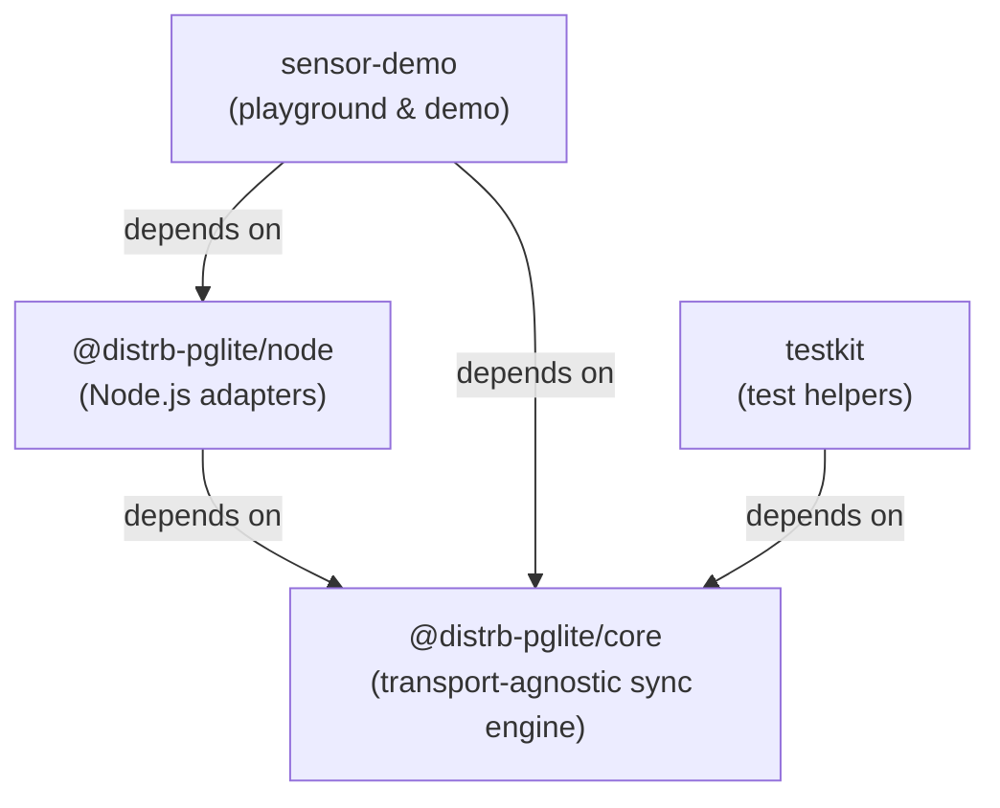
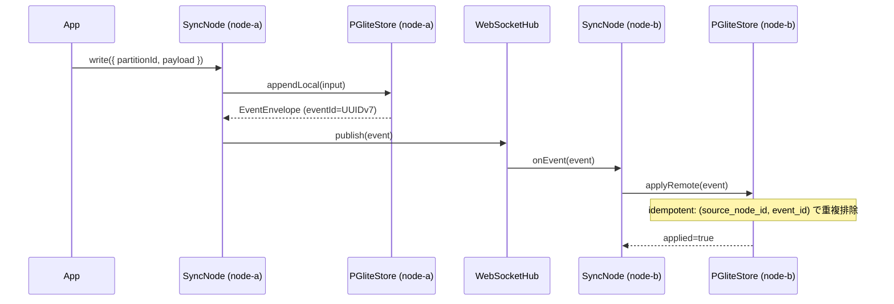
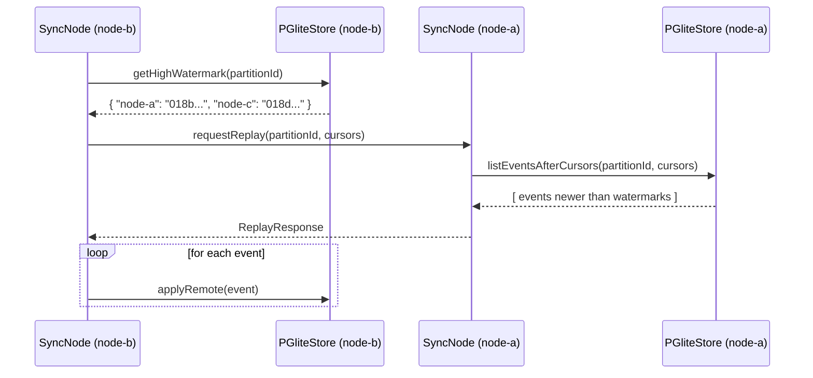
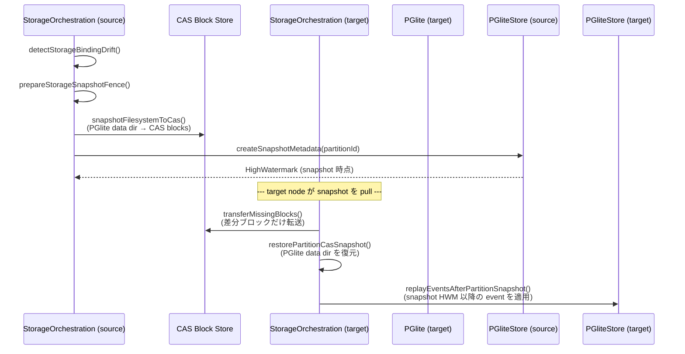
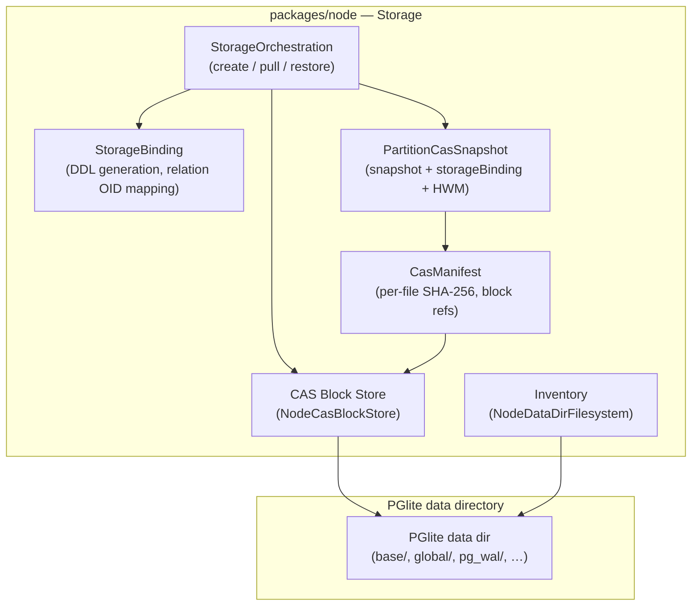
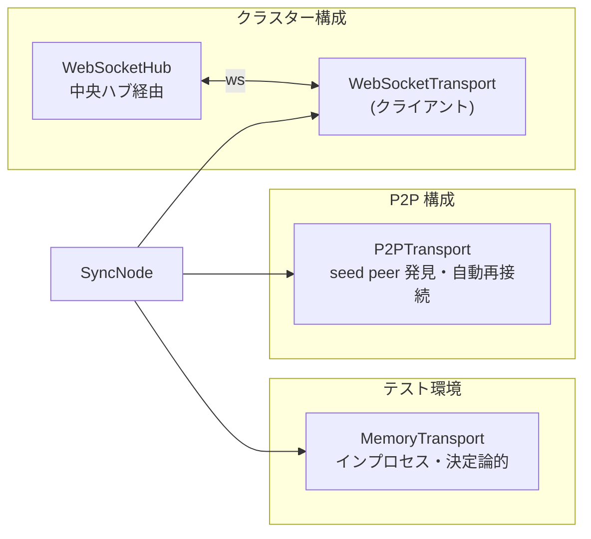
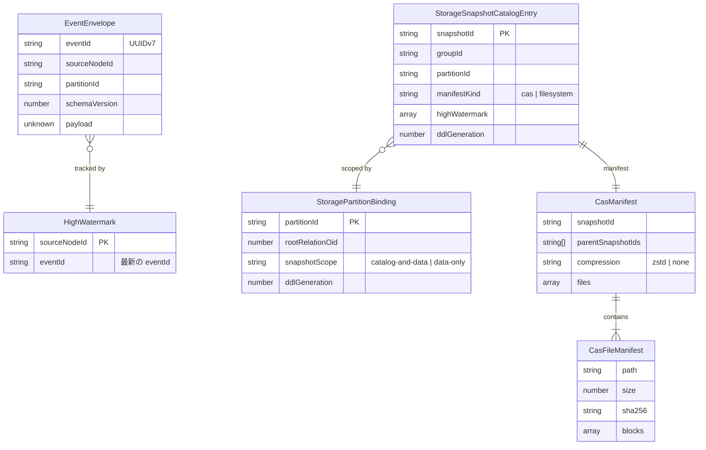

# Architecture

distrb-pglite は「各ノードがローカルの PGlite を持ち、必要な partition だけを非同期で同期する」
edge database layer のプロトタイプです。
中央 coordinator も global transaction も持たず、収束は結果整合性に委ねます。

---

## パッケージ構成

```
packages/
  core/          イベントモデル・PartitionStore インターフェース・SyncNode・MemoryTransport
  node/          PGlite ストア・WebSocket Transport・CAS スナップショット・ストレージ orchestration
  testkit/       共有テストヘルパー
  sensor-demo/   センサーデモ・ブラウザ playground
```



---

## コアコンポーネント

Application code should normally enter through `DistributedPGlite` or
`DistributedBrowserPGlite`. These facades expose the product contract:
local SQL (`query` / `exec`), partition writes, catchup, event inspection, and
snapshot operations. Lower-level building blocks remain available for tests and
research, but facade instances expose them only through `internals`.

### 公開 API と internals の線引き

- **公開 API(後方互換性を意識する面)**: facade のメソッドと open オプション、
  core の型(`EventEnvelope` など)、`Transport` インターフェース、
  `SyncTelemetrySink`、`SingleWriterRegistry`。
- **internals(契約外)**: facade の `internals` getter から触れる
  `SyncNode`・store・PGlite インスタンスと、`@distrb-pglite/node` の
  storage orchestration / CAS / inventory ヘルパー群。テスト・研究・
  上位レイヤー実装のために export しているが、シグネチャは予告なく変わる。
- 迷ったら: facade で表現できないユースケースが出たときは internals に
  手を伸ばすのではなく、facade に何が足りないかを先に問う。


---

## イベントレプリケーションの流れ



---

## イベント catchup (cursor による差分取得)

node-b が一時的に切断していた場合など、HighWatermark ベクターで差分だけ取り寄せます。



---

## CAS スナップショットと復元の流れ

大量の event replay を避けたい場合や新規ノードの bootstrap に使います。



---

## ストレージレイヤーの構造



---

## Transport の切り替え

Transport はインターフェースで抽象化されており、環境に合わせて差し替えられます。



---

## データモデル (主要型)



---

## Partition 所有権の保証レベル (ADR 0006)

partition は常に単一 writer という前提だが、ライブラリが提供するのは**検出**であって**強制**ではない。

- `singleWriter` オプションは opt-in。未指定なら所有権チェックは一切行われない。
- 所有権はローカル知識。`claimPartition` / `transferPartition` はローカルの
  `SingleWriterRegistry` を更新するだけで、レプリケーションも永続化も
  旧 writer の fence もしない。所有権の配布と fencing は上位レイヤーの責務。
- registry を渡した場合: 違反するリモートイベントは skip され
  `onSingleWriterViolation` と telemetry に報告される。違反するローカル書き込みは throw する。
- 詳細は [ADR 0006](adr/0006-single-writer-partition-ownership.md) の Guarantee Level を参照。

---

## テレメトリ

core は OpenTelemetry に依存しない。代わりに構造化イベントの observer hook
(`SyncTelemetrySink`)を公開し、OTel exporter・ロガー・メトリクスは利用側が
1 つの adapter 関数として被せる。

```ts
const db = await DistributedPGlite.open({
  // ...
  telemetry: (event) => {
    // event は判別可能 union: sync-started / sync-stopped / local-write /
    // remote-event (applied | duplicate | rejected-single-writer) /
    // replay-served / catchup / subscription-recovered
    meter.counterFor(event.type).add(1);
  },
});
```

- sink が throw してもレプリケーションは壊れない(エラーは握りつぶす契約)。
- sink 未指定時はゼロコスト。

---

## Event log compaction (ADR 0008)

event log は append-only だが、snapshot を anchor にして有限長に保てる。

- prune は「retained な bootstrap 可能 snapshot の high-watermark 以下」のみ。
  facade の `pruneEvents` がこの anchor 検証を行う(明示 API のみ、自動 prune はまだない)。
- `pruned_through` は partition × source node の永続 cursor vector。
  冪等性の床も兼ねる: floor 以下のイベントの再配送は duplicate として拒否される。
- prune 済みの範囲に cursor が落ちる replay 要求には、部分的なイベント列ではなく
  `snapshot-required` 応答が返り、要求側は `SnapshotRequiredError` を受けて
  snapshot pull で回復する。wire protocol v2(hello の `protocolVersion`)で運ばれ、
  v1 の peer には silent な空応答ではなく timeout で失敗させる。
- prune 後、anchor snapshot は最適化ではなく回復経路の一部になる
  (ADR 0008 の Relationship to ADR 0007 を参照)。

---

## 物理レプリケーションの contract (ADR 0009)

論理面の `Transport` と対になる物理面の contract が `SnapshotSource`。
責務は**発見**(peer が広告する snapshot catalog entries の列挙)と
**転送**(1 entry の不足 block をローカル block store に揃える)の 2 つだけ。
検証(ADR 0007 の fence)・entry 選択・復元は consumer 側に残る:
source 実装は「list と fetch」より賢くなってはいけない。

- content-addressed なので転送は冪等・再開可能で、提供側を信頼しなくてよい
- facade に `snapshotSource` を構成すると、`catchUpFrom` が
  `SnapshotRequiredError` から透過的に回復する(pull → replay → catchup)
- 実装: `StaticSnapshotSource`(テスト/移行用、core)、
  `SharedDirSnapshotSource`(共有ファイルシステム、node)。
  wire protocol 上の block 転送は将来の実装(contract は変えずに足せる)
- `pullSnapshot` の `snapshotEntries` / `sourceCasDir` 引数は
  「呼び出し側が source を兼ねる」退化ケースとして残る移行経路

また `vacuumPolicy.autoPruneEvents` を有効にすると、`runCasGc` が
CAS block の GC と同じ retention 判断で各 partition の event log を
「最古の retained bootstrap anchor の HWM」まで自動 prune する。
retention window 内の遅れは replay で、それ以遅は snapshot pull で
回復する、という猶予が policy から自動的に導かれる。

---

## エコシステムの責務境界

このライブラリは WireGuard 相当のレイヤーであり、Tailscale 的な
ネットワーキング層(認証・認可・ノード発見・鍵配布・メンバーシップ管理)は
責務外。relay/hub(`WebSocketHub`)は transport と authorization の
入口だけを持ち、ストレージのセマンティクスは manifest・event log・
CAS block store に閉じる。これらの上位機能は別レイヤー/別プロダクトとして
被せる前提で、core の API はそれを妨げない形を保つ。

---

## 主要なアーキテクチャ決定

| ADR                                                   | 決定                                                                         |
| ----------------------------------------------------- | ---------------------------------------------------------------------------- |
| [0001](adr/0001-eventual-consistency.md)              | global transaction を持たず、結果整合性のみ                                  |
| [0002](adr/0002-transport-abstraction.md)             | Transport を VFS 的インターフェースで抽象化                                  |
| [0003](adr/0003-node-adapter-boundary.md)             | core はランタイム非依存、Node.js 依存は packages/node に閉じ込める           |
| [0004](adr/0004-per-node-uuidv7-cursors.md)           | cursor は global clock でなく source node ごとの UUIDv7 HighWatermark vector |
| [0005](adr/0005-storage-layer-escalation.md)          | PGlite を black box として扱い、smgr には入らない                            |
| [0006](adr/0006-single-writer-partition-ownership.md) | partition は常に単一 writer、競合 merge は実装しない                         |
| [0007](adr/0007-logical-source-of-truth.md)           | 論理層が正本、物理 snapshot は version/generation fence 付きの最適化         |
| [0008](adr/0008-event-log-compaction.md)              | snapshot-anchored な event log compaction、replay gap は明示応答             |
| [0009](adr/0009-physical-replication-contract.md)     | 物理面の contract `SnapshotSource`(発見+転送のみ、検証/選択/復元は外)      |
