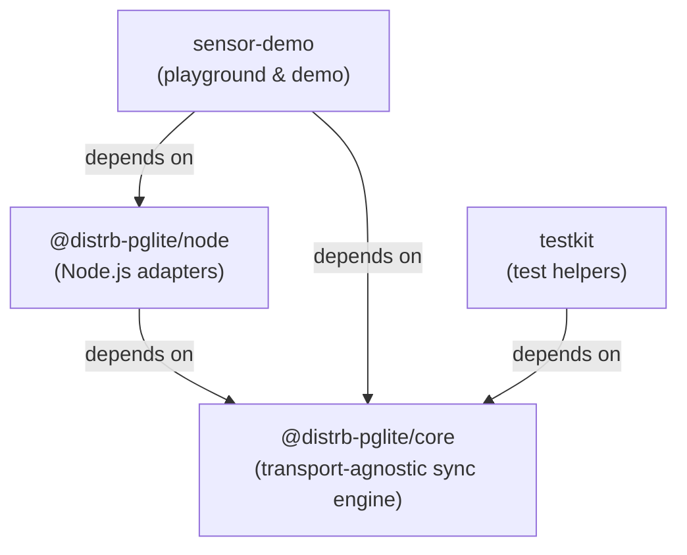
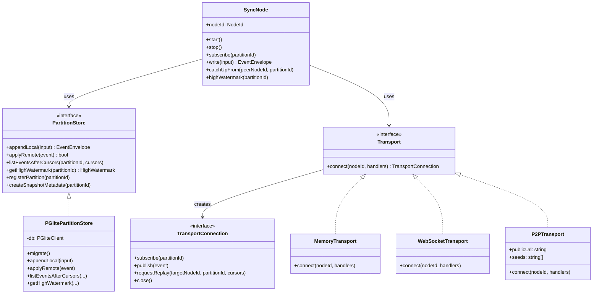
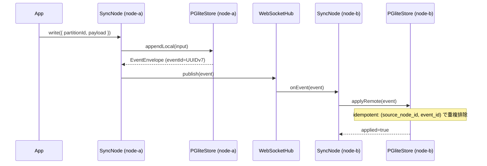
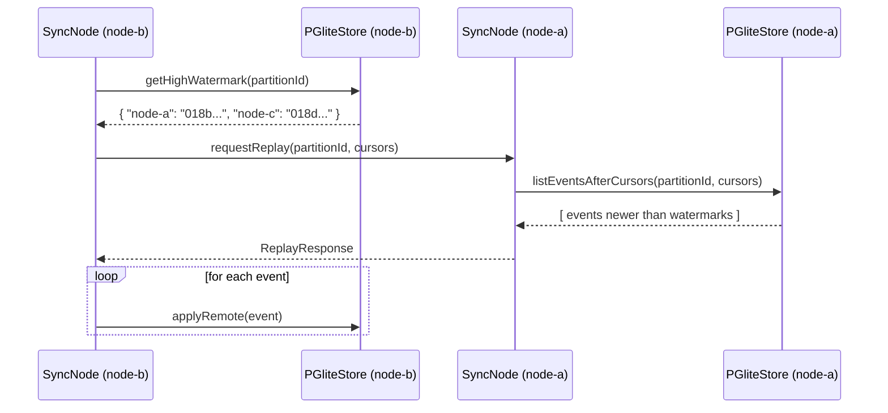
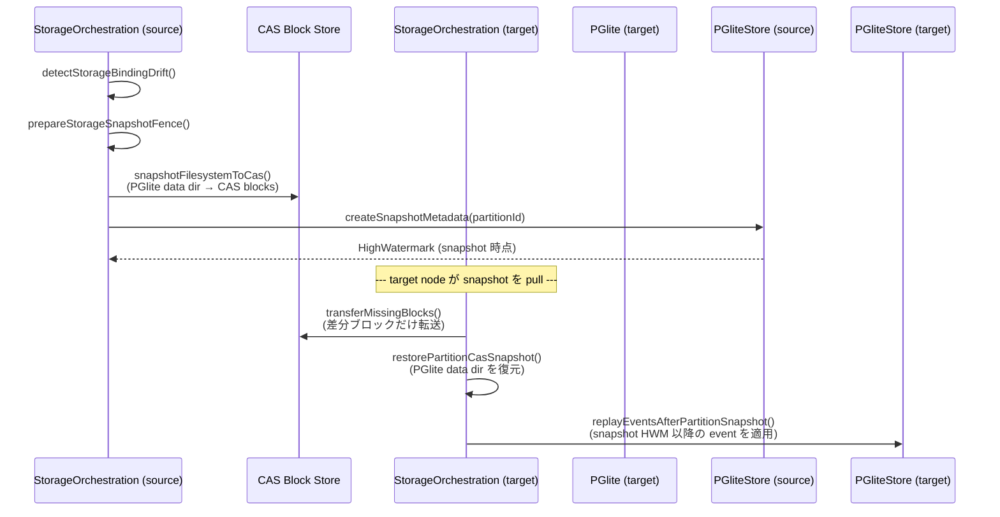
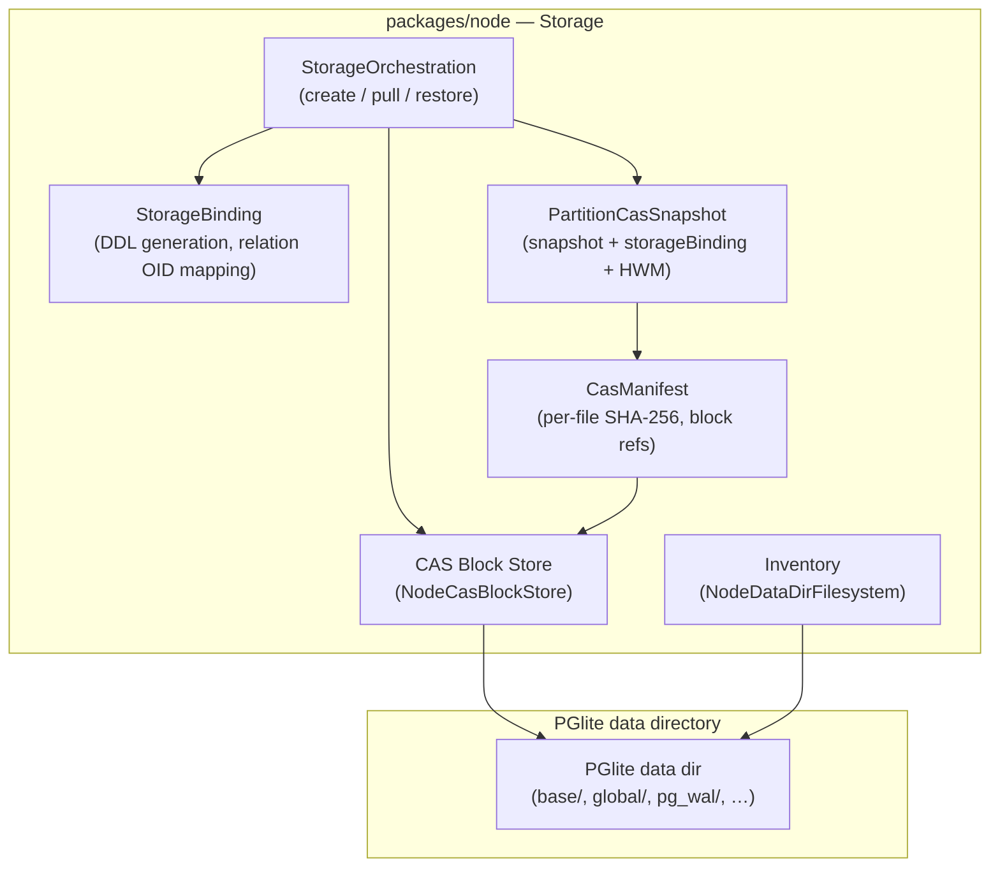
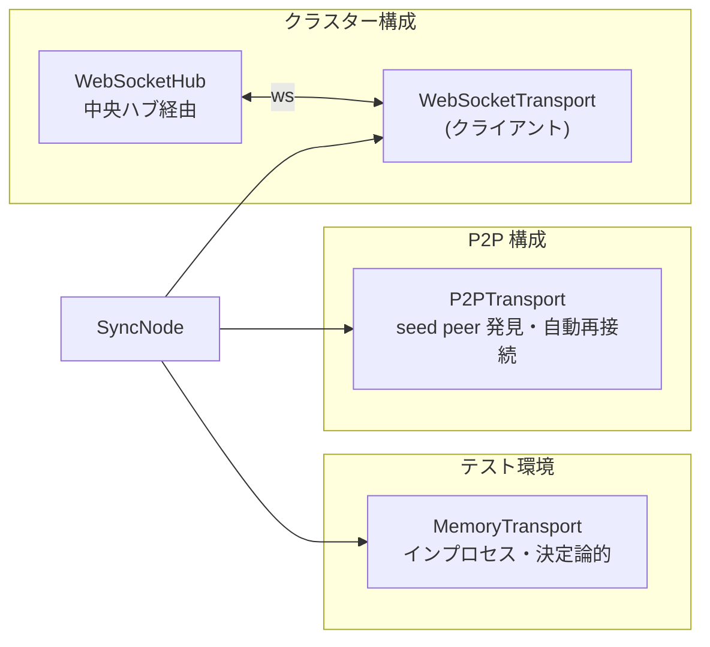
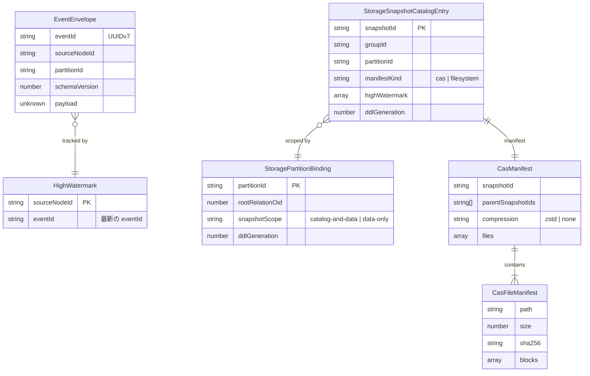

# Architecture

distrb-pglite は「各ノードがローカルの PGlite を持ち、必要な partition だけを非同期で同期する」
edge database layer のプロトタイプです。
中央 coordinator も global transaction も持たず、収束は結果整合性に委ねます。

---

## パッケージ構成

```
packages/
  core/          イベントモデル・PartitionStore インターフェース・SyncNode・MemoryTransport
  node/          PGlite ストア・WebSocket Transport・CAS スナップショット・ストレージ orchestration
  testkit/       共有テストヘルパー
  sensor-demo/   センサーデモ・ブラウザ playground
```



---

## コアコンポーネント

Application code should normally enter through `DistributedPGlite` or
`DistributedBrowserPGlite`. These facades expose the product contract:
local SQL (`query` / `exec`), partition writes, catchup, event inspection, and
snapshot operations. Lower-level building blocks remain available for tests and
research, but facade instances expose them only through `internals`.



---

## イベントレプリケーションの流れ



---

## イベント catchup (cursor による差分取得)

node-b が一時的に切断していた場合など、HighWatermark ベクターで差分だけ取り寄せます。



---

## CAS スナップショットと復元の流れ

大量の event replay を避けたい場合や新規ノードの bootstrap に使います。



---

## ストレージレイヤーの構造



---

## Transport の切り替え

Transport はインターフェースで抽象化されており、環境に合わせて差し替えられます。



---

## データモデル (主要型)



---

## 主要なアーキテクチャ決定

| ADR                                          | 決定                                                                         |
| -------------------------------------------- | ---------------------------------------------------------------------------- |
| [0001](adr/0001-eventual-consistency.md)     | global transaction を持たず、結果整合性のみ                                  |
| [0002](adr/0002-transport-abstraction.md)    | Transport を VFS 的インターフェースで抽象化                                  |
| [0003](adr/0003-node-adapter-boundary.md)    | core はランタイム非依存、Node.js 依存は packages/node に閉じ込める           |
| [0004](adr/0004-per-node-uuidv7-cursors.md)  | cursor は global clock でなく source node ごとの UUIDv7 HighWatermark vector |
| [0005](adr/0005-storage-layer-escalation.md) | PGlite を black box として扱い、smgr には入らない                            |
| [0006](adr/0006-single-writer-partition-ownership.md) | partition は常に単一 writer、競合 merge は実装しない                |
| [0007](adr/0007-logical-source-of-truth.md)  | 論理層が正本、物理 snapshot は version/generation fence 付きの最適化         |
